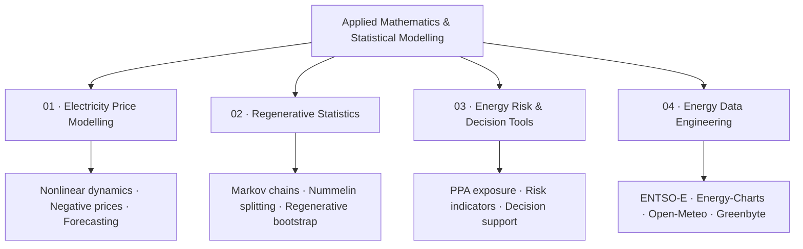

<!--
Profile README for github.com/Anoune1946
Research portfolio: mathematical methods, reproducible computation and energy-market applications.
-->

# Anoune Mergane

**CIFRE PhD Researcher in Applied Mathematics**  
*Stochastic Modelling · Statistical Inference · Quantitative Energy Research*

I am a PhD researcher in applied mathematics at **MODAL’X, Université Paris Nanterre**, working in collaboration with **CGN Europe Energy** through a CIFRE industrial PhD programme.

My doctoral research, entitled **“Modelling Electricity Spot Prices Using Regenerative Markov Chains and Prediction”**, focuses on the modelling and forecasting of electricity spot prices using regenerative Markov chains and statistical methods. I work at the intersection of probability, mathematical statistics, nonlinear time series and energy-market applications.

My goal is to connect mathematical rigour with reproducible computational methods and decision-relevant questions from the electricity sector.

---

## Research portfolio

The portfolio is organised around four complementary areas:

### 01 — Electricity Price Modelling

Research on the nonlinear dynamics of European wholesale electricity prices, with a particular focus on negative-price episodes, market regimes and interpretable statistical forecasting.

**Current public research repository**

[Structural Non-Linearity and Negative Electricity Prices](https://github.com/Anoune1946/Structural-Non-Linearity-and-Negative-Electricity-Prices)

Topics include:
- Smooth-transition nonlinear time-series models.
- Price dynamics across different supply-demand conditions.
- Empirical comparison across France, Germany/Luxembourg and Spain.
- Chronological evaluation, diagnostics and reproducibility.

### 02 — Regenerative Statistics

Mathematical and computational methods for dependent stochastic processes, developed as part of my doctoral research.

Research topics:
- Markov chains and stochastic processes.
- Nummelin splitting and regeneration.
- Regenerative bootstrap and block resampling.
- Statistical inference for dependent observations.
- Extreme-value analysis and finite-sample Monte Carlo studies.

### 03 — Energy Risk & Decision Tools

Applied quantitative work related to electricity-market risk and renewable-energy assets.

Areas of application:
- Negative electricity-price monitoring.
- Power Purchase Agreement (PPA) exposure.
- Risk indicators for renewable generation.
- Forecasting tools and human-in-the-loop decision support.

Some industrial work is conducted in a private environment and is therefore not published in this portfolio.

### 04 — Energy Data Engineering

Building data workflows for European electricity-market analysis, renewable generation and forecasting.

**Public project space**

[Electricity Price Forecasting](https://github.com/Anoune1946/electricity-price-forecasting)

Data sources and API experience:
- [ENTSO-E Transparency Platform](https://transparency.entsoe.eu/) — European electricity-market data and forecasts.
- [Energy-Charts](https://energy-charts.info/) — electricity generation, load and market data through public APIs.
- [Open-Meteo](https://open-meteo.com/) — weather data and forecast APIs for energy-related modelling.
- **Greenbyte and other private operational APIs** — renewable-asset production and operational data, handled within the relevant access and confidentiality constraints.

Technical focus:
- API-based data acquisition, local caching and data validation.
- Day-Ahead information sets and forecast-origin discipline.
- Hourly and quarter-hourly time-series alignment.
- Weather, market and renewable-generation data integration.
- Chronological backtesting and reproducible data pipelines.

---

## Professional experience

| Period | Position | Organisation | Main activities |
|---|---|---|---|
| **May 2024 – Present** | CIFRE PhD Researcher in Applied Mathematics | **CGN Europe Energy** · In collaboration with Université Paris Nanterre | Statistical modelling and forecasting of electricity prices; quantitative analysis for energy-market applications. |
| **October 2023 – April 2024** | Data Scientist | **Université Paris Nanterre** | Statistical analysis of EEG data in linguistics; comparison of brain-activity patterns between native and late deaf participants; contribution to applied-statistics research. |
| **March 2023 – September 2023** | Data Scientist Intern | **Capgemini** | EEG data processing and statistical analysis; signal processing using short-time Fourier transforms (STFT) and wavelets; machine-learning methods and communication of results to project teams. |
| **April 2021 – September 2021** | Statistical Studies Intern | **CERAAS**, Thiès, Senegal | Design and analysis of agricultural experiments; measurement of crop production and quality; statistical modelling and interpretation of experimental results. |

## Education

| Period | Degree | Institution |
|---|---|---|
| **2022 – 2023** | Master 2 (M2), **ISÉFAR — Statistical Engineering and Economics of Finance, Insurance and Risk**, Risk Statistics track | **Université Paris Nanterre** |
| **2019 – 2020** | Master’s degree in **Mathematics and Applications** | **Université de Thiès**, Senegal |
| **2017 – 2018** | Bachelor’s degree in **Mathematics and Computer Science** | **Université de Thiès**, Senegal |

My academic training combines probability, statistics, stochastic modelling, time series, statistical programming, optimisation, risk analysis and data analysis.

---

## Scientific presentations

- **Forum Entreprises & Mathématiques (FEM 2026)** — poster presentation, Campus des Cordeliers, Sorbonne Université, Paris, **17 November 2026**.
- **Chaire Économie du Climat** — research presentation, Palais Brongniart, Paris, **11 September 2026**.
- **11th Rencontres des Jeunes Statisticien·nes (RJS)** — Porquerolles, **17–21 May 2026**.
- **Colloque International Francophone de Probabilités et Statistique en Interactions (CIF-PSI)** — research presentation, AIMS Senegal (M’bour) and Université Gaston Berger (Saint-Louis), **8–10 July 2025**.

## Scientific and academic event organisation

- **Doctoral seminars of the Fédération Parisienne de Modélisation Mathématique (FP2M)** — member of the organising team. The seminars bring together early-career researchers from member laboratories, including MAP5, SAMM, MODAL’X and CES, for short talks in applied mathematics, probability, statistics, modelling and networks. [FP2M seminars and events](https://fp2m.math.cnrs.fr/ephemeres.html).
- **“Non-stationnarité et statistiques pour l’EEG”** — member of the local organising team, Nanterre, **4–5 September 2025**. [Conference website](https://stateeg.sciencesconf.org/).

---

## Methods & technical skills

**Mathematics and statistics**
- Markov chains and stochastic processes.
- Regenerative methods and bootstrap.
- Nonlinear time-series modelling.
- Statistical inference and Monte Carlo simulation.
- Extreme-value methods and rare-event analysis.
- Experimental design and statistical modelling.

**Data science, machine learning and programming**
- Python and R.
- NumPy, pandas, SciPy, scikit-learn and statsmodels.
- Statistical learning, machine-learning model development and forecasting.
- Exploration and development of approaches based on foundation models for data and time-series applications.
- Data processing, visualisation and model evaluation.

**Data engineering and APIs**
- API integration, data acquisition and local caching.
- ENTSO-E, Energy-Charts and Open-Meteo.
- Experience with private operational data APIs, including Greenbyte.
- Temporal alignment, data-quality checks and reproducible workflows.

**Signal processing**
- EEG data analysis.
- Short-time Fourier transform (STFT).
- Wavelet transforms.

**Scientific and engineering tools**
- Jupyter, Git and LaTeX.
- Streamlit and scientific visualisation tools.
- Experience with SQL and numerical-computing environments.

---

## Research principles

- **Information-set discipline:** use only variables available at the declared forecast origin.
- **Temporal consistency:** preserve the native resolution of market data; do not create artificial quarter-hourly forecasts from hourly observations.
- **Chronological evaluation:** distinguish estimation, validation and test periods.
- **Statistical interpretability:** connect modelling choices to the underlying stochastic and economic questions.
- **Reproducibility:** document data provenance, assumptions, dependencies, limitations and computational experiments.
- **Data confidentiality:** keep private API credentials, operational datasets and company-sensitive information out of public repositories.

---

## Collaboration and interests

I am interested in research collaborations and applied quantitative projects in:

- Stochastic processes and mathematical statistics.
- Regenerative methods for dependent data.
- Electricity-market modelling and renewable energy.
- Statistical and machine-learning forecasting, including emerging foundation-model approaches.
- Energy data engineering, risk analysis and decision support.

For professional and research details, see my [LinkedIn profile](https://www.linkedin.com/in/anoune-mergane-740aa3253/).

---

*Applied mathematics · Reproducible research · Energy-market applications*
