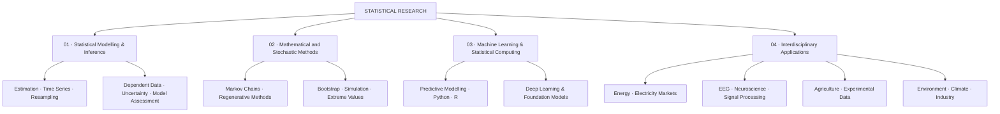

<!--
Profile README for github.com/Anoune1946
Professional identity: statistical research, methodological development and interdisciplinary applications.
-->

# Anoune Mergane

**CIFRE PhD Researcher | Applied Statistics · Statistical Modelling · Inference**

I am a researcher in **statistics and applied mathematical modelling**, currently completing a CIFRE PhD at **MODAL’X, Université Paris Nanterre**, in partnership with **CGN Europe Energy**.

My research is primarily oriented towards **statistical methodology**: statistical modelling, estimation and inference, time-series analysis, resampling methods and computational statistics. My doctoral work uses Markov chains and regenerative methods as mathematical tools to study dependent data and develop statistical procedures.

My research applications include electricity markets, EEG and signal data, and experimental agricultural data. I am interested in transferring statistical methods across scientific fields rather than limiting my work to one application area.

---

## Research portfolio

My profile is organised around a central discipline — **statistics** — supported by mathematical methods, computational tools and applications in several scientific fields.

### 01 — Statistical Modelling & Inference

My core research area: statistical modelling, estimation, inference, time-series analysis, dependent data, resampling methods, uncertainty assessment and computational statistics.

### 02 — Mathematical and Stochastic Methods

Mathematical tools supporting my statistical research, including Markov chains, stochastic processes, Nummelin splitting, regenerative structures, regenerative bootstrap, simulation and extreme-value methods.

### 03 — Machine Learning & Statistical Computing

Development and evaluation of predictive models, statistical learning methods and computational workflows using Python and R. I also explore deep-learning and foundation-model approaches for temporal and structured data.

### 04 — Interdisciplinary Applications

I apply statistical reasoning to different types of scientific and industrial problems:

- **Energy and electricity markets:** nonlinear price modelling, negative-price episodes, forecasting and PPA risk analysis.
- **EEG and neuroscience:** statistical analysis of EEG data, group comparisons and signal processing.
- **Agriculture and experimental sciences:** experimental design, field-trial analysis and statistical modelling.
- **Other scientific domains:** interest in adapting statistical methods to environmental, climate, health, industrial and engineering data.

The first three areas reflect professional and research experience. The other domains indicate directions for future interdisciplinary collaborations.

---

## Research applications

My statistical work has been applied to different types of scientific and industrial problems:

| Domain | Experience and research questions |
|---|---|
| **Energy and electricity markets** | Nonlinear price modelling, negative-price episodes, forecasting and PPA risk analysis in an industrial CIFRE context. |
| **Neuroscience and EEG** | Statistical analysis of EEG data in linguistics, comparison of participant groups, signal processing and applied-statistics research. |
| **Agriculture and experimental sciences** | Experimental design, field-trial analysis, measurement of production and quality, and statistical modelling. |
| **Interdisciplinary data science** | Interest in adapting statistical methods to environmental, climate, industrial, health and engineering data. |

The first three areas correspond to professional or research experience. The last describes fields in which I am interested in developing further collaborations.

---

## Selected research projects

### Electricity price modelling

Research on nonlinear dynamics in European wholesale electricity prices, negative-price episodes and interpretable forecasting.

[Structural Non-Linearity and Negative Electricity Prices](https://github.com/Anoune1946/Structural-Non-Linearity-and-Negative-Electricity-Prices)

### Statistical and computational forecasting

A project space for time-series forecasting, energy-market data and reproducible statistical workflows.

[Electricity Price Forecasting](https://github.com/Anoune1946/electricity-price-forecasting)

### Regenerative statistics

Doctoral research on regenerative Markov-chain methods and statistical procedures for dependent observations. Public research code and methodological material will be added when ready for release.

### Energy risk and decision support

Applied work on negative-price monitoring, renewable-energy exposure and PPA-related decision support. Some industrial work remains private and is not included in this public portfolio.

---

## Professional experience

| Period | Position | Organisation | Main activities |
|---|---|---|---|
| **May 2024 – Present** | CIFRE PhD Researcher | **CGN Europe Energy** · MODAL’X, Université Paris Nanterre | Statistical modelling and forecasting of electricity prices; methodological research and quantitative applications for energy markets. |
| **October 2023 – April 2024** | Data Scientist | **Université Paris Nanterre** | Statistical analysis of EEG data in linguistics; analysis of differences between native and late deaf participants; contribution to applied-statistics research. |
| **March 2023 – September 2023** | Data Scientist Intern | **Capgemini** | EEG data processing, statistical analysis, signal processing using STFT and wavelet transforms, machine-learning methods and communication of results to project teams. |
| **April 2021 – September 2021** | Statistical Studies Intern | **CERAAS**, Thiès, Senegal | Experimental design and field-trial analysis; measurement of agricultural production and quality; statistical modelling and interpretation of results. |

---

## University teaching experience

**Teaching assistant / Vacataire d’enseignement — 64 hours HETD**  
Université Paris Nanterre · **2023–2026**

Teaching and tutorial activities across several undergraduate programmes:

- **Descriptive Statistics** — Licence 1, UFR SPSE (Psychology and Education Sciences).
- **Analysis I** — Licence 1, UFR SEGMI (Economics, Management, Mathematics and Computer Science).
- **General Mathematics** — Licence 1, UFR SITEC (Industrial Systems and Communication Technologies).
- **Academic tutoring** — Licence 1 and 2 students in SEGMI and Master MEEF students preparing for primary-school teaching, through SUFOM.

This experience includes teaching across different student backgrounds, explaining quantitative concepts and supporting students in their mathematical and statistical learning.

**Lecturer / Chargé d’enseignement — 36 hours**
Institut Supérieur d’Économie et de Management (ISEM), Thiès, Senegal · **2021–2022**

- **Applied Mathematics for Management** — Licence 1, Semester 2.
- Responsibilities: Full course ownership, including designing lecture notes, exercise sheets, and final exam papers, as well as grading scripts.

---

## Education

| Period | Degree | Institution |
|---|---|---|
| **2022–2023** | Master 2 (M2), **ISÉFAR — Statistical Engineering and Economics of Finance, Insurance and Risk**, Risk Statistics track | **Université Paris Nanterre** |
| **2019–2020** | Master’s degree in **Mathematics and Applications** | **Université de Thiès**, Senegal |
| **2017–2018** | Bachelor’s degree in **Mathematics and Computer Science** | **Université de Thiès**, Senegal |

My academic training includes statistical modelling, probability and statistics, stochastic simulation, time series, optimisation, experimental design, programming and data analysis.

---

## Scientific presentations

- **Forum Entreprises & Mathématiques (FEM 2026)** — poster presentation, Campus des Cordeliers, Sorbonne Université, Paris, **17 November 2026**.
- **Chaire Économie du Climat** — research presentation, Palais Brongniart, Paris, **11 September 2026**.
- **11th Rencontres des Jeunes Statisticien·nes (RJS)** — Porquerolles, **17–21 May 2026**.
- **Colloque International Francophone de Probabilités et Statistique en Interactions (CIF-PSI)** — AIMS Senegal, M’bour, and Université Gaston Berger, Saint-Louis, **8–10 July 2025**.

## Scientific organisation and academic service

- **Fédération Parisienne de Modélisation Mathématique (FP2M)** — member of the organising team for the doctoral seminars. These seminars bring together early-career researchers from member laboratories, including MAP5, SAMM, MODAL’X and CES, for short talks in applied mathematics, statistics, modelling and related fields. [FP2M seminars](https://fp2m.math.cnrs.fr/ephemeres.html).
- **“Non-stationnarité et statistiques pour l’EEG”** — member of the local organising team, Nanterre, **4–5 September 2025**. [Conference website](https://stateeg.sciencesconf.org/).

---

## Technical environment

**Statistical computing:** Python · R · NumPy · pandas · SciPy · scikit-learn · statsmodels

**Machine learning and modelling:** statistical learning · predictive modelling · nonlinear models · deep-learning and foundation-model approaches under development

**Data workflows and sources:** ENTSO-E · Energy-Charts · Open-Meteo · Greenbyte and other private operational APIs

**Research tools:** Jupyter · Git · LaTeX · Streamlit · scientific visualisation

**Signal processing:** EEG analysis · short-time Fourier transform (STFT) · wavelet transforms

Private API credentials, operational datasets and company-confidential information are not published in this portfolio.

---

## Research interests and opportunities

I am interested in academic and applied research opportunities in:

- Applied statistics and statistical methodology.
- Statistical modelling, estimation and inference.
- Time series, dependent data and resampling methods.
- Computational statistics and predictive modelling.
- Interdisciplinary data science in energy, environment, climate, health, industry and engineering.

I am particularly interested in collaborative research settings where statistical methods are developed, evaluated and adapted to answer scientific questions in different application domains.

For professional details, see my [LinkedIn profile](https://www.linkedin.com/in/anoune-mergane-740aa3253/).

---

*Statistical research · Methodological development · Interdisciplinary applications*
